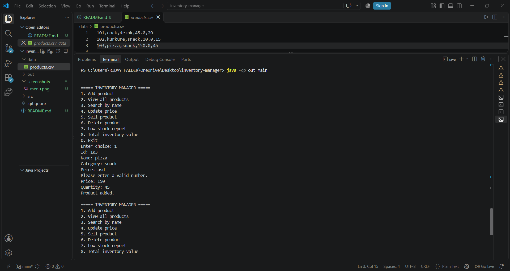
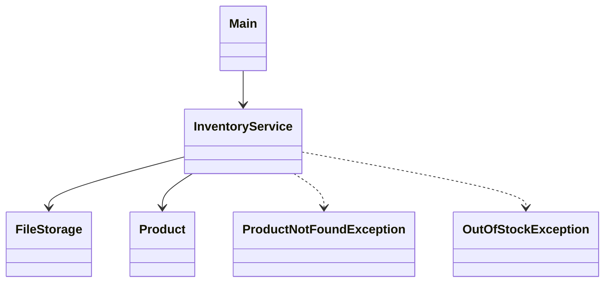

# Inventory Manager (Java)

A console-based inventory management system for small shops, built to replace
notebook stock tracking. Add products, record sales, search stock, and get
low-stock alerts, with data saved automatically between runs.

## Why I built this
[2-3 sentences in your own words: who has this problem, what it looks like
today, why you chose it.]

## Features
- Add, view, search, update, and delete products
- Record sales with stock validation (no selling more than available)
- Low-stock report with a custom threshold
- Total inventory value
- Data saved to a CSV file and loaded on startup
- Input validation and clear error messages (no crashes on bad input)

## Screenshots



## Tech
Java 17+ (tested on JDK 27), collections (HashMap), streams, custom exceptions,
file I/O (java.nio), Git

## Project structure
```
src/
├── Main.java                 console menu (input/output only)
├── model/Product.java        data and validation
├── service/InventoryService  business logic
├── storage/FileStorage       CSV persistence
└── exception/                ProductNotFoundException, OutOfStockException
```

## Design

Each layer has one job: `Main` talks to the user, `InventoryService` holds the
rules, `FileStorage` handles saving. This makes it easy to replace the storage
with a database later.

## How to run
```
git clone https://github.com/riday1512-dotcom/inventory-manager.git
cd inventory-manager
javac -d out -sourcepath src src/Main.java
java -cp out Main
```
Data is saved to `data/products.csv`, which is created automatically.

## What I learned
- [Encapsulation: validating data in one place so invalid products can't exist]
- [A real bug you hit and how you fixed it]
- [One more thing, in your own words]

## Next steps
- Move storage from CSV to MySQL using JDBC
- Rebuild as a REST API with Spring Boot

## How I built this
I used Claude as a mentor while learning: for explanations, project planning,
and code review. I wrote, tested, and debugged the code myself, including
fixing setup and compiler errors along the way.